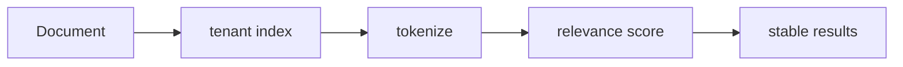

# Search and Ranking Service

**Sohail Sharif · Personal engineering project · Core prototype**

## Problem
This project explores tenant indexing, ranking, filters, relevance evaluation. It is designed as a focused engineering lab for Python roles.

## Current implementation
Tenant-scoped lexical ranking and deterministic tie breaking. See source and executable tests for the exact behavior.

This repository is an initial implementation, not a deployed production system. The full target architecture below is a roadmap. No throughput, uptime, savings or recovery claims have been measured for a production environment.

## Target stack
Python, FastAPI, Elasticsearch

## Architecture


The diagram describes the target architecture; adapters listed below are not implemented yet.

## Run and verify
Run from this directory. Requires Python 3.11 or later; standard library only.

```sh
python -m unittest discover -s tests -v
```

## Next milestones
- [ ] Elasticsearch adapter
- [ ] FastAPI endpoint
- [ ] judged relevance dataset
- [ ] ranking experiments

## Trade-offs
- The domain core is isolated from infrastructure so its invariants can be tested quickly.
- In-memory state makes the prototype reproducible but does not survive restarts or coordinate multiple machines.
- Production authentication, secret management, persistence, metrics and deployment verification remain required.

## Evidence
Tests are executable specifications. Cloud and load-test results are deliberately unclaimed. Record real commands, versions, hardware, dataset, date and results in `docs/VALIDATION.md` before quoting numbers on a resume.

## Interview discussion
Explain the failure boundary, tenant boundary, consistency model, retry behavior, operational signals and why the chosen persistence adapter fits the workload.
